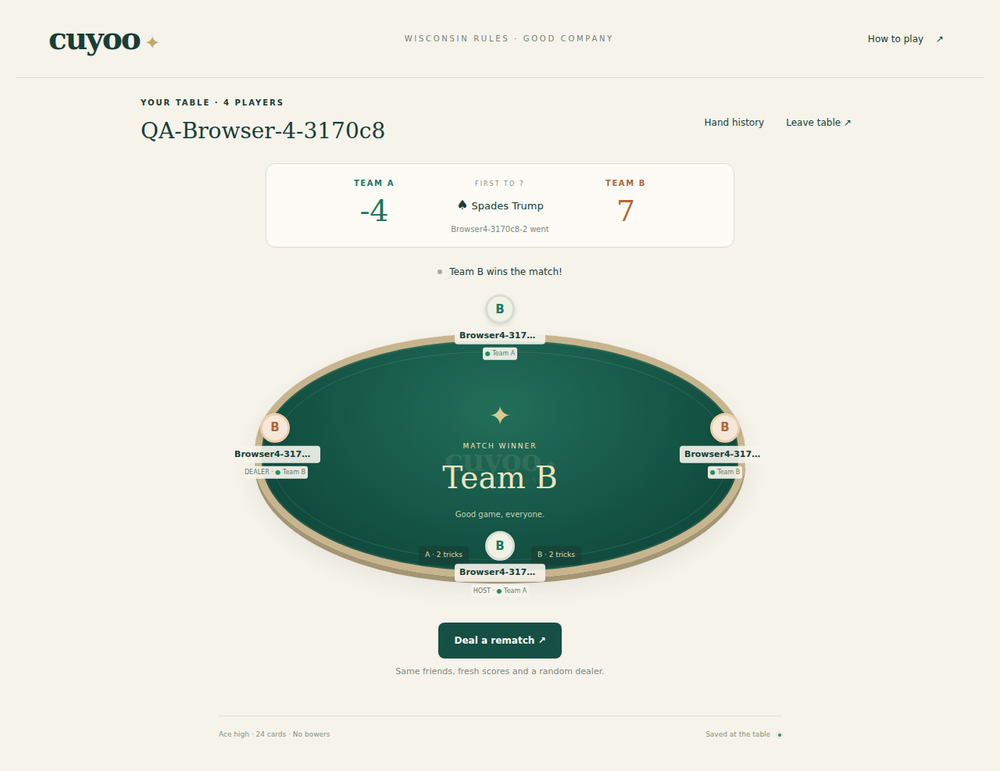
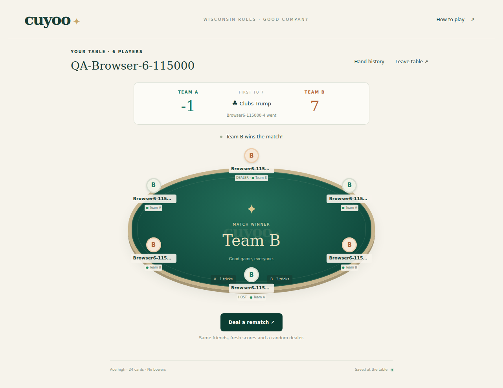
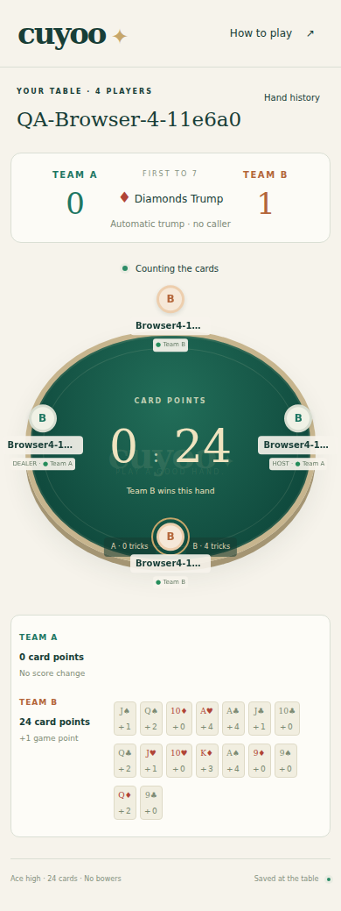
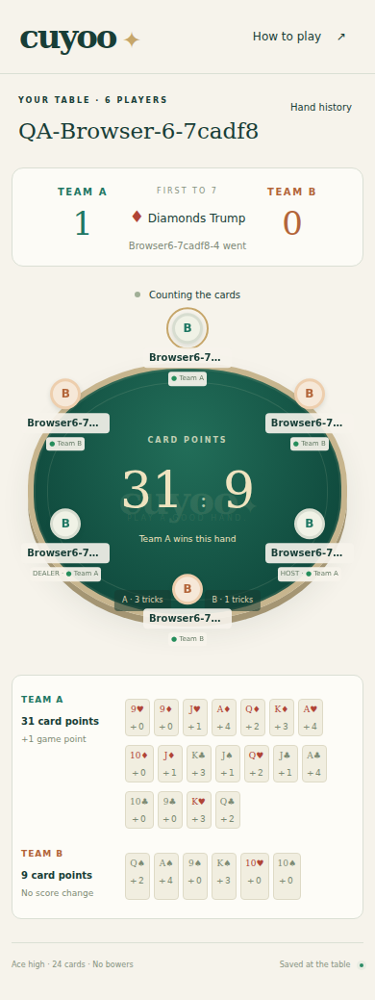

# Verification evidence

## Rules, persistence and concurrency

18 Node test entries passed: 13 independent rules fixtures, four actual Workers/D1 integration subtests and their wrapper. Expected fixtures independently verify every cut gap, exact two-card packet order, four-player remainder/top/bottom trump, six-player exposed dealer card/second round/all-pass, legal discards/trumping/ace-high winners, card conservation, four tricks, point totals, fewer tricks winning more points, penalties/ties/negative scores/threshold crossing, dealer rotation and rematches.

Integration uses real Miniflare/workerd with a temporary persistent D1 database and distinct anonymous cookie sessions. Verified overfill/join/start races, one seat per device, private whitelist projections, replayed/stale actions, controller leases, origin/unknown-write rejection, host transfer, rejoining an emptied lobby, full four/six-session matches and rematches. Disposing/recreating the Worker with the same D1 preserves hand/version. Only synthetic local deadlines are accelerated administratively; the deployed API has no clock or raw-state mutation endpoint.

TypeScript, full repository source lint and production build passed. Generated runtime/build copies are excluded from source lint.

## Actual HTTPS backend matches

These use real server timers and independent device-cookie jars, without privileged database access.

| Players | Hands | Card plays | Final A : B | Seconds including network assertions | Rematch |
| --- | ---: | ---: | --- | ---: | --- |
| 4 | 11 | 176 | 7 : -1 | 393 | Reset passed |
| 6 | 19 | 456 | 1 : 7 | 965 | Reset passed |

## Actual independent browser matches

Playwright 1.62.1 with fresh Chromium 153.0.8010.0 BrowserContexts against the deployed HTTPS app. Every seat had a distinct secure cookie; extra/duplicate identities never counted as seated players. Actions were actual create/join/start/slider/pass/trump/card/rematch UI interactions. Read-only API observations verified privacy, shared seats/teams, actor/trump/tricks/scores and accepted versions. Raw private snapshots and cookies are excluded from evidence.

| Players / isolated contexts | Hands | UI card plays | Final A : B | Seconds including deliberate outages/delays | Rematch |
| --- | ---: | ---: | --- | ---: | --- |
| 4 / 4 | 10 | 160 | -4 : 7 | 587 | Reset; dealer 0 then 2 |
| 6 / 6 | 13 | 312 | -1 : 7 | 1014 | Reset; dealer 3 then 3 |

A fresh uniform sample can select the same dealer. Six-player rematch did exactly that; no forced different-seat rule was added.

Both runs passed shared lobby/full-room/manual start, separate own hands, outsider read rejection, duplicate-tab read-only control, cutter-only slider, touch and keyboard gap changes, four-player automatic trump and six-player second-round choice, legal UI cards, complete scoring/history and host rematch. Refreshed cutter, trump actor/caller, current and non-current players, collection and count. Seats/hands/scores survived temporary offline mode. A 22-second host outage retained host ownership and all seats without replacement. Delaying an already accepted play response beyond the frontend timeout triggered a retry with the SAME intention ID; exactly one card left the hand and entered the trick.

Every participant observed shuffle, cut, deal, trump, play, collect, count and completion. One seat per mode used reduced motion. No uncaught app errors or unexpected app console errors were recorded. Expected offline/authorization network failures are test inputs. Aggregate files: [results.json](browser-evidence/results.json), [four-player](browser-evidence/result-4.json), [six-player](browser-evidence/result-6.json).

Separate actual waiting-lobby browser test passed deterministic host transfer, disabled incomplete start, departed-player read rejection and next-joiner host ownership after everyone left. All participants left that synthetic lobby: [lobby-result.json](browser-evidence/lobby-result.json).

## Phone presentation and motion

Desktop 1280×900 and phone widths 390 and 320 passed horizontal-overflow checks. Manual screenshots show readable private cards, touch controls, legible scores/turn/trump and six-seat positioning. Long seat names are bounded with ellipsis/tooltips and full accessible played-card labels. A measured overlapping-label issue was corrected: six-player center cards now use two spaced rows; label widths are bounded. Bounding-box checks passed at 320px.

Accepted event IDs drive a bounded three-frame presentation queue. Reload/reconnection catches up directly. Shuffle, confirmed split/rejoin, packet deal, public trump reveal, directional card play, winner highlight/collection, actual captured-card counting and match feedback are short transform/opacity animations. Reduced motion bypasses queued playback and minimizes CSS motion without changing server outcomes. Performance findings are observed layout/motion behavior; no hardware-phone frame-rate claim is made.

Full browser matches loaded version 6 and persisted through the version 7 deployment. Version 7's final directional-play/count-timing/win presentation was checked with additional real four/six-context one-hand fixtures. Final count layouts contained all 16 or 24 recorded cards with correct visible totals/deltas, and no phone card/label overlap. Static count screenshots finish finite CSS animation solely for inspection; server timers/results remain unchanged.

Final visual fixture totals: four-player 0 : 24 (16 scored cards), six-player 31 : 9 (24 cards / 40 points). See [visual results](visual-final/results.json). The two short fixtures stop after the counted hand; they are presentation checks, alongside the complete-match evidence above.

The actual cloud desktop browser also verified public no-account entry, shared lobby/create/seats, incomplete start, reload, second-tab observation and leave. Its single-cookie profile is additional inspection, not the independent-player proof.

## Deployment and scope

The selected project appgprj_6acaf74b5fcc8191903fb83f348ad81d is owner-controlled/public at https://cuyoo-table.warm-ghost-4468.chatgpt.site/. Native live database overview confirmed dedicated binding DB and tables rooms/sessions. GitHub target is Tingbing/Cuyoo; main stays at initialization e018f92bc170aa2f8c7bc26664037327896900a5. No unrelated app/database or paid upgrade was used.

No known functional blocker remains. Hardware Safari/phone GPU/FPS benchmarking was outside this Chromium viewport run. Synthetic rooms are identifiable by QA names and expire through the normal 24h waiting / 7d active-room retention policy. Started rematch/short-visual fixtures retain reserved seats; no privileged cleanup endpoint was introduced.
