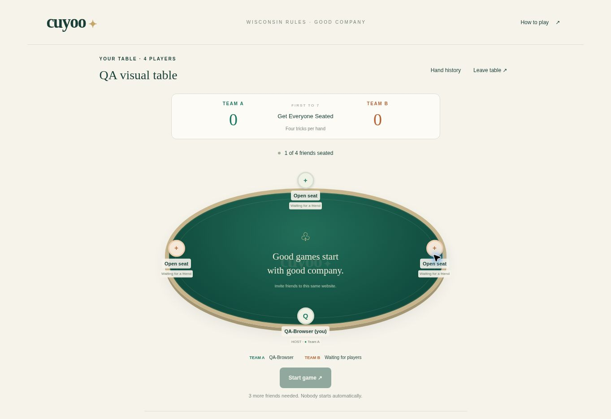

# Verification evidence

## Passed locally

- 13 independent rules fixtures; all card ranks, point totals, cut gaps, legal move rules, four/six deal order, four-player fallback, six-player second round/all-pass, caller penalty, ties, negative scores, threshold crossing, privacy projection and dealer rotation.
- Four D1 integration subtests (18 total Node test entries when combined with rules): actual Cloudflare Workers runtime with persistent D1, independent cookie sessions, overfill race, one device seat, manual start, duplicates/stale requests, host transfer, rejoining an emptied lobby, origin checks, private projections, complete 4-player and 6-player matches and fresh rematches.
- Worker disposal/recreation with the same D1 storage preserves the current hand and state version.
- TypeScript, focused application/server lint and production build pass.

The complete-match test driver now chooses callers from a consistent team. An earlier random-choice simulation could wander through many penalties without reaching seven before its artificial iteration budget. The driver was corrected; actual scoring rules were preserved. Local integration advances synthetic deadlines administratively to keep tests quick; there is no production clock endpoint.

## Verified in the deployed desktop browser

The actual HTTPS Site opens without an account wall. Observed: shared live lobby, username input, game creation, four-seat table and team assignment, disabled Start while incomplete, reload restoring the same seat/name, and second tab showing the same seat read-only with disabled actions. Desktop lobby and waiting table are legible with clear seat/score/actions and no observed overlap. Browser logs show only browser-extension metadata errors, no observed application errors in this flow.

## Outstanding

Independent four- and six-browser-context matches, phone viewport inspection, live cut/deal/play/collection/count animations, keyboard/touch slider inspection, reduced-motion behavior and temporary network outage across all relevant phases have not been fully verified. The available cloud browser shares a single cookie profile and exposes no independent-context creation or viewport-resize API. Local Playwright has no Chromium executable. Two tabs on one identity are NOT counted as two players.

Live four-session HTTPS match passed: 11 hands, 176 plays, 393 seconds, final score 7 to −1; rematch reset passed. Six-session verification is still running. Full results are recorded in IMPLEMENTATION_PROGRESS.md. The HTTPS test initially failed because its Node cookie handling overwrote the device cookie with a gateway cookie; the test now retains each cookie by name. The browser itself retained its device session correctly.

This is an implemented, deployed test build and a draft PR, not a claim that all readiness criteria are complete.
